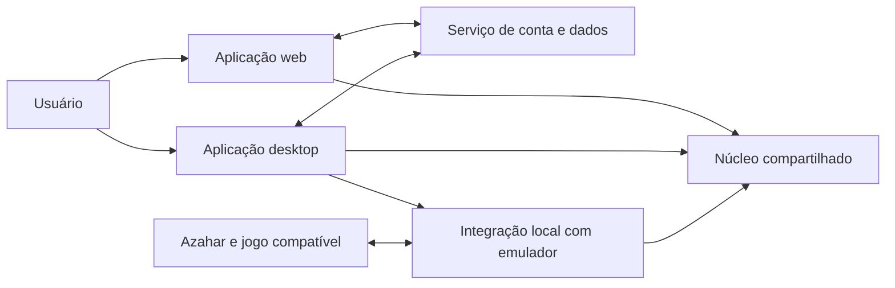

# Arquitetura inicial

## Objetivo

Organizar o PokéRunner para que a experiência web e o aplicativo desktop compartilhem as funções comuns, enquanto recursos específicos — como a conexão com o emulador — permaneçam isolados.

Esta é uma arquitetura inicial. A estrutura poderá mudar conforme validarmos as funções e aprendermos mais sobre os projetos anteriores.

## Visão geral

O PokéRunner terá quatro partes principais:

1. **Web:** interface pública para consultar dados, montar times e fazer análises manuais.
2. **Desktop:** oferece as funções da web e acrescenta o modo Real Time.
3. **Núcleo compartilhado:** concentra regras e cálculos de Pokémon usados pelas duas interfaces.
4. **Serviço online:** cuida das contas e dos dados que o usuário deseja acessar tanto no site quanto no aplicativo.

A conexão com emuladores será uma integração separada. A primeira combinação planejada para avaliação é Windows, Azahar e Pokémon Omega Ruby/Alpha Sapphire.

## Componentes

### Aplicação web

Responsável por:

- consultar a Pokédex;
- montar e salvar times;
- sugerir golpes durante a montagem;
- analisar cobertura de tipos e fraquezas;
- oferecer batalha manual, com um oponente escolhido pelo usuário;
- permitir o acesso à conta e aos dados sincronizados.

As partes que não dependem de dados pessoais poderão ser avaliadas para uso sem login. Salvar e sincronizar dados exigirá uma conta.

### Aplicação desktop

Responsável por oferecer as funções comuns do PokéRunner e, futuramente, o modo Real Time.

O aplicativo desktop será responsável pela comunicação local com a integração do emulador. A interface deverá mostrar o estado dessa conexão e informar quando não puder confirmar dados da batalha.

### Núcleo compartilhado

Concentra funções que devem se comportar da mesma forma no site e no aplicativo, por exemplo:

- relações de efetividade entre tipos;
- análise de cobertura e fraquezas de um time;
- sugestões de golpes;
- recomendações para uma batalha;
- validação dos dados de um time.

O núcleo não deve depender de uma tela específica nem de um emulador.

### Integração com o emulador

A integração Real Time ficará isolada do núcleo e das telas comuns. Ela será responsável por conversar com o emulador e obter os dados que forem tecnicamente acessíveis.

A primeira integração a ser investigada é Azahar com Pokémon Omega Ruby/Alpha Sapphire no Windows. Compatibilidade com outros emuladores ou jogos dependerá de avaliações próprias; não será presumida.

O núcleo deverá receber informações da batalha por uma interface definida, sem precisar conhecer os detalhes internos de cada emulador.

### Serviço de conta e sincronização

Um serviço online será necessário para cadastro, autenticação e sincronização entre web e desktop.

Ele poderá armazenar dados do PokéRunner, como:

- times e golpes escolhidos;
- Pokémon marcados pelo usuário;
- preferências da conta.

A sincronização do save ou do progresso dentro do jogo não está definida como função do PokéRunner.

A implementação deverá proteger credenciais e dados pessoais. Senhas não devem ser armazenadas em texto puro. O provedor de autenticação, o banco de dados e as regras de retenção ainda serão escolhidos.

## Fluxo simplificado



## Estrutura de pastas proposta

A estrutura abaixo é uma proposta para organizar o repositório. Os nomes e a divisão podem ser ajustados antes da criação do código.

```text
pokerunner/
├── apps/
│   ├── web/                 # Site público
│   ├── desktop/             # Aplicativo para Windows
│   └── api/                 # Conta e sincronização online
├── packages/
│   ├── core/                # Regras e análises compartilhadas
│   ├── data/                # Acesso e adaptação a dados de Pokémon
│   └── emulator-azahar/     # Integração inicial com Azahar e ORAS
├── docs/
│   ├── product-vision.md
│   ├── legacy-review.md
│   └── architecture.md
└── README.md
```

Essa estrutura não significa que todas as partes serão implementadas ao mesmo tempo. O serviço online e a integração Real Time podem ser desenvolvidos em etapas próprias, depois que as funções básicas estiverem mais claras.

## Princípios

- Manter as regras de batalha separadas da interface.
- Compartilhar entre web e desktop as funções que servem às duas experiências.
- Isolar cada integração com emulador.
- Explicar recomendações e indicar quando os dados forem incompletos.
- Não tratar um golpe sugerido como se já estivesse no time do usuário.
- Nas batalhas, usar os golpes escolhidos pelo usuário e, no modo Real Time, os golpes atuais somente quando puderem ser confirmados.
- Evitar enviar dados locais do emulador ao serviço online sem necessidade e sem uma decisão explícita.
- Manter credenciais fora do repositório e proteger os dados da conta.

## Decisões ainda em aberto

Antes de implementar as partes correspondentes, será necessário decidir:

- provedor de autenticação e armazenamento das contas;
- quais funções estarão disponíveis sem login;
- quais dados poderão ser sincronizados;
- fonte e estratégia de atualização dos dados de Pokémon;
- como o aplicativo desktop será distribuído e atualizado;
- como a integração Real Time obterá dados do Azahar e do jogo;
- como detectar e comunicar falhas de conexão ou dados indisponíveis.