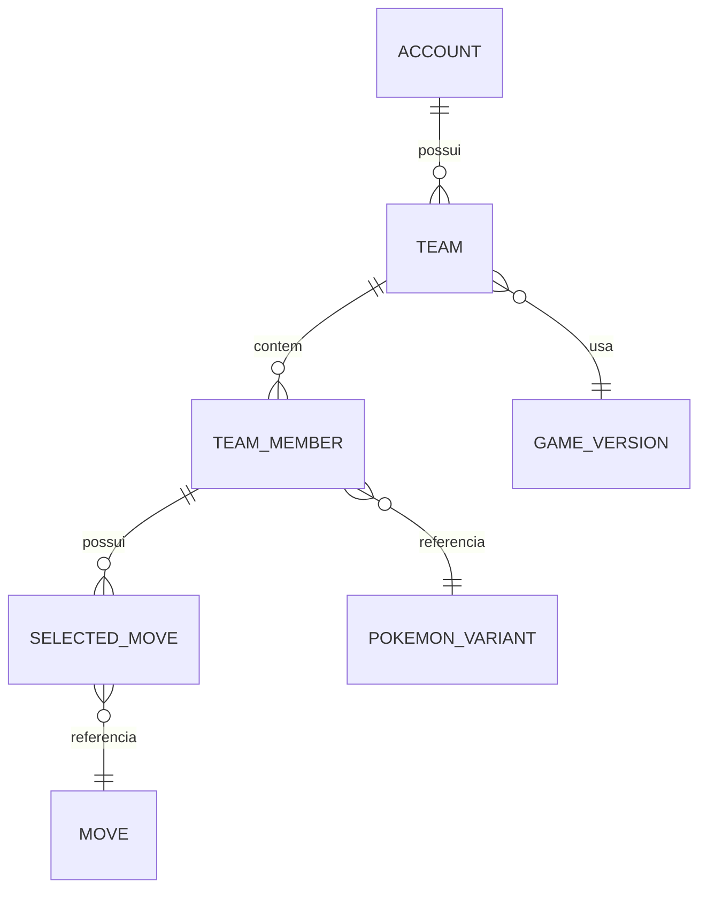

# Modelo inicial de dados

## Objetivo

Descrever quais dados o PokéRunner precisa relacionar para salvar os times e os golpes escolhidos pelo usuário.

Este modelo é conceitual. Ainda não define tabelas SQL, banco definitivo nem provedor de autenticação.

## Separação dos dados

O projeto terá dois grupos de dados.

### Catálogo público de Pokémon

O catálogo será uma cópia organizada dos dados consultados na PokéAPI. Ele será compartilhado entre os usuários e não pertence a uma conta individual.

O catálogo poderá conter:

- espécies de Pokémon;
- formas e variantes;
- tipos;
- golpes;
- grupos de jogos;
- disponibilidade de golpes por jogo;
- locais e detalhes de captura por jogo.

A estrutura e o processo de atualização desse catálogo ainda precisam ser definidos.

### Dados da conta

Inicialmente, a conta guardará times e golpes escolhidos. A identidade da conta virá do provedor de autenticação, que ainda será escolhido.

Os dados privados serão acessados pela API do PokéRunner. O site e o aplicativo não poderão definir livremente a qual conta um time pertence; o servidor usará a identidade autenticada da solicitação.

## Entidades conceituais

### Conta

Representa o usuário autenticado. O PokéRunner usará o identificador verificado pelo serviço de autenticação.

Não está decidido se precisaremos manter uma tabela própria para dados da conta.

### Time

Pertence a uma conta e representa uma equipe criada pelo usuário.

Um time terá:

- identificador;
- dono;
- nome;
- jogo ou grupo de jogos selecionado;
- lista de integrantes.

### Integrante do time

Representa um Pokémon em uma posição do time. Deve guardar uma referência à espécie e à forma ou variante escolhida.

Um time poderá ter até seis integrantes.

### Golpe escolhido

Representa um golpe que o usuário escolheu para um integrante do time.

Cada integrante poderá ter até quatro golpes escolhidos. Uma sugestão só será gravada como golpe do integrante depois que o usuário a selecionar.

## Relacionamentos

`POKEMON_VARIANT`, `MOVE` e `GAME_VERSION` representam referências ao catálogo compartilhado, não dados particulares da conta.

## Relação com a batalha

A batalha manual e as recomendações usarão os golpes escolhidos para os integrantes do time.

No modo Real Time futuro, o aplicativo poderá receber dados temporários da batalha local. Esses dados só serão considerados os golpes atuais quando puderem ser confirmados; não serão confundidos com as escolhas salvas no time.

## Validações propostas

- Uma conta só pode consultar ou alterar seus próprios times.
- Um time terá até seis integrantes.
- Um integrante terá até quatro golpes escolhidos.
- A forma ou variante deve corresponder ao Pokémon selecionado.
- A disponibilidade de um golpe deve ser conferida para o jogo escolhido.
- A API deverá validar as referências ao catálogo antes de salvar.

## Decisões ainda em aberto

- Provedor de autenticação e representação da identidade da conta.
- Estrutura final das tabelas e identificadores.
- Banco de dados e hospedagem.
- Como armazenar e consultar o catálogo compartilhado.
- Se o usuário poderá salvar times incompletos enquanto ainda os monta.
- Como tratar formas temporárias de batalha, como Mega Evolução, em cada recurso.